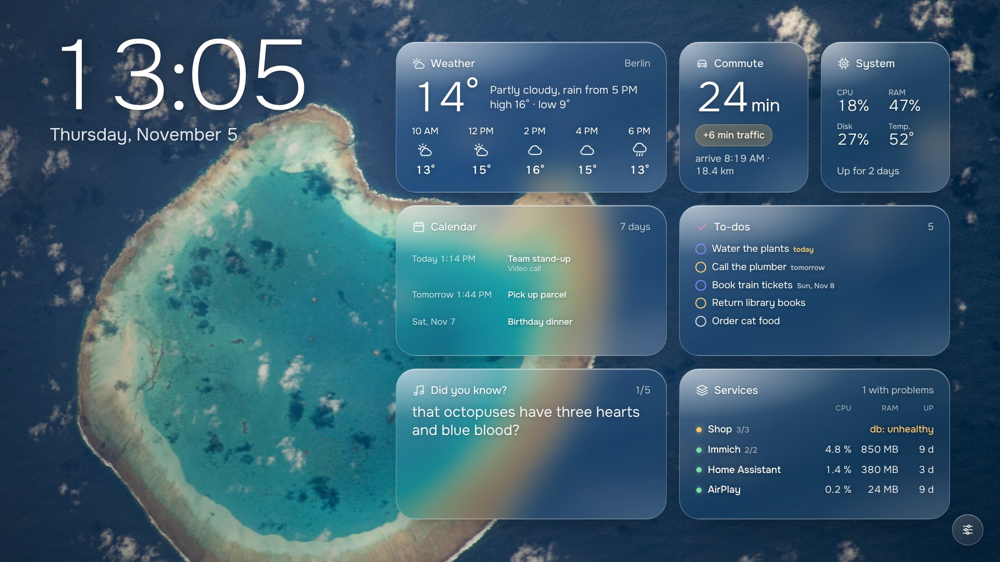
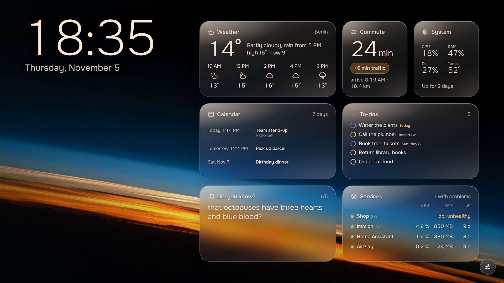
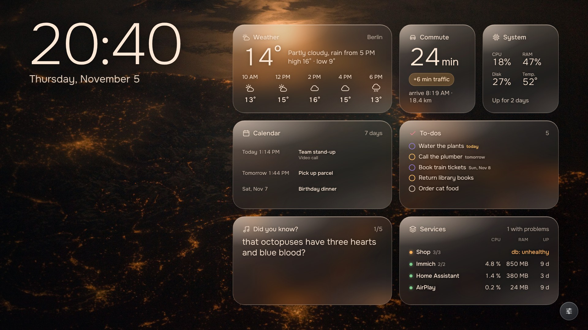
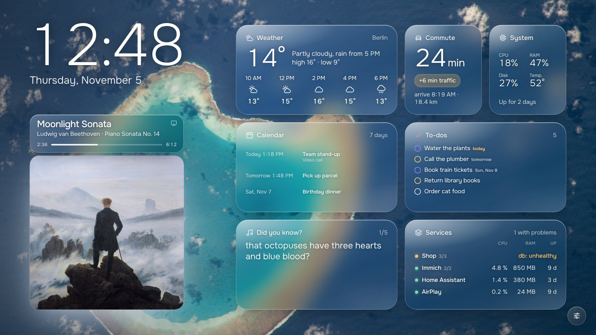
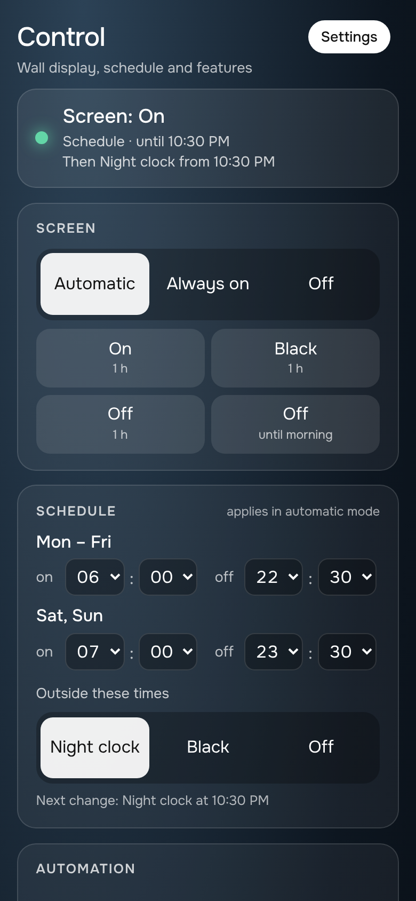
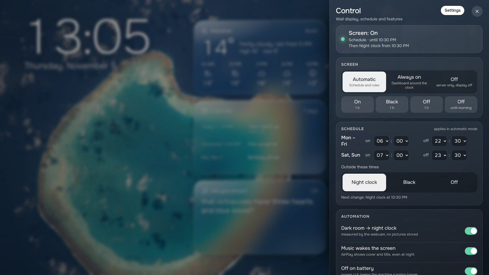

# Reframe

**Give an old laptop's screen a second life as a wall dashboard.**

Most of us have an old laptop in a drawer. The screen is fine, the battery is
tired, and it is too slow for today's browser tabs. Reframe turns it into the
nicest corner of your home: a glassy dashboard with the clock, the weather,
your calendar and to-dos, the state of your home server and what is playing,
over slow video or soft gradients, running day and night on a few watts.

It runs in Docker, so it works on any Linux laptop, and it installs as an app on
[umbrelOS](https://umbrel.com). A browser on a phone or tablet shows the same
dashboard.



<sub>Sample data. The background is a NASA astronaut photograph (public domain);
Reframe plays your own clips in its place, see [Your own video](#your-own-video).</sub>

## What you get

- **A calm wall display.** The scene follows the sun: morning, day, evening and
  late each have their own light. At night the screen dims to a clock, or goes
  off, by a schedule you set.
- **Tiles that matter.** Weather (no account needed), calendar (any iCal link:
  Apple, Google, Outlook, Nextcloud), to-dos you tick off on the wall or from
  your phone, the state of your containers, system load, a commute estimate,
  Wikipedia, Home Assistant, photo-library numbers from Immich.
- **Music.** Play something to the AirPlay speaker "Reframe" and the wall shows
  the cover, title and progress, and takes on the cover's colour.
- **A display that looks after itself.** Brightness follows the room (with the
  webcam, if you allow it: it reads a few grey pixels in memory and never keeps
  a picture), the screen sleeps on a schedule, a tap wakes it, and a power cut
  switches it off.
- **Set up in the browser.** No config files. English and German built in.

<p>


</p>



<sub>Music mode with a piece that is free to use: Beethoven's Moonlight Sonata
(1801) and Caspar David Friedrich's "Wanderer above the Sea of Fog" (c. 1818),
both in the public domain.</sub>

<p>


</p>

## Try it in a minute

You need Docker. Nothing else.

```sh
git clone https://github.com/PaulWeber-co/reframe.git
cd reframe
docker compose up -d
```

Open <http://localhost:7777>. It shows sample data until you open
<http://localhost:7777/setup> and tell it where you live and what to connect.
The image is `ghcr.io/paulweber-co/reframe`; `docker compose` pulls it, or
builds it from this folder if the image is not there yet.

## On the laptop's own display

This is the point of the project, and the part that depends on your hardware.
On a **Linux** laptop that runs without a desktop session (a server install of
Debian or Ubuntu, or umbrelOS):

```sh
docker compose --profile kiosk up -d
```

That starts Chromium full screen on the laptop's display. It runs **without a
privileged container**: only the graphics card and the input devices are handed
in, and brightness is dimmed in the page. If your machine does not accept that,
`--profile kiosk-full` is the same with full rights (real backlight, webcam
sensor, powering the panel down). Add `--profile airplay` for the AirPlay
speaker and `--profile services` for the Services tile.
[docs/hardware.md](docs/hardware.md) explains how it works, what to check first,
and how to report what worked on your machine.

## On umbrelOS

Reframe is a community app for Umbrel. In umbrelOS open the App Store, choose
**Community App Stores** from the menu and add

```
https://github.com/PaulWeber-co/reframe
```

Then install **Reframe** (the dashboard, for any browser) or **Reframe Display**
(the dashboard plus the kiosk and an AirPlay speaker for the machine Umbrel runs
on; no privileged container, the graphics card comes from Umbrel's GPU
permission). Details, what is verified and what Umbrel's own store rules say:
[docs/umbrel.md](docs/umbrel.md).

## Your own video

Reframe ships no video: the clips you would want come with licenses that do not
allow passing them on. Put your own in the `media` folder and the wall plays
them behind the tiles, by time of day. Drone footage works beautifully.

```sh
docker compose run --rm -v "$PWD/clips:/clips:ro" reframe reframe-media add day /clips/coast.mov
```

That converts the clip to something a laptop plays without effort and makes the
still picture for it. [media/README.md](media/README.md) has the details. Without
clips you get slowly drifting colour in the tones of the scene.

## The tiles

| Tile | Shows | Needs |
| --- | --- | --- |
| Weather | now, the next hours, rain | a place (search it in Settings) |
| Calendar | the next seven days | one or more iCal / webcal links |
| To-dos | open items, due dates, a colour per person | nothing: the list lives here |
| System | CPU, memory, disk, temperature, uptime | nothing |
| Services | your containers, problems first | the `services` profile |
| Commute | drive time with traffic, in a morning window | a free TomTom key |
| Wikipedia | on this day, did you know, article of the day | nothing |
| Home | Home Assistant entities, lights you can tap | a Home Assistant token |
| Photos | counts from your Immich library | an Immich API key |

Drag tiles around by pressing and holding one; add or hide them in the control
center. Writing your own tile takes two files: [docs/widgets.md](docs/widgets.md).

## Where things stand

| | |
| --- | --- |
| Dashboard, setup, control center, to-dos, widgets | tested: about 200 unit tests, host-helper tests and a smoke test, all in CI |
| Container files, compose profiles, Umbrel app files | validated (`docker compose config`), image build in CI |
| The kiosk chain (cage without a seat daemon, Chromium, the scripts) | verified without a screen, in CI (`scripts/kiosk-headless-check.sh`) |
| Taking over a real display, touch, brightness, webcam | built from established patterns, **not yet verified on hardware** |
| AirPlay from a phone | the same setup that ran on a real machine, **not yet verified in this form** |
| Installing the Umbrel apps on umbrelOS | **not yet verified** |

If you try the kiosk or the Umbrel app, a short report helps everyone:
[CONTRIBUTING.md](CONTRIBUTING.md#hardware-reports-are-the-most-useful-thing).

## More

- [Installation](docs/installation.md) · [Configuration](docs/configuration.md) · [Hardware](docs/hardware.md)
- [umbrelOS](docs/umbrel.md) · [How it fits together](docs/architecture.md) · [Writing a tile](docs/widgets.md)
- [Security](SECURITY.md) · [Attribution](ATTRIBUTION.md) · [Contributing](CONTRIBUTING.md)

Reframe started as the dashboard of one old laptop that became a home server.
If you want umbrelOS itself in a container, see the
[umbrelOS container fork](https://github.com/PaulWeber-co/umbrel2.0docker).

MIT licensed, see [LICENSE](LICENSE).
